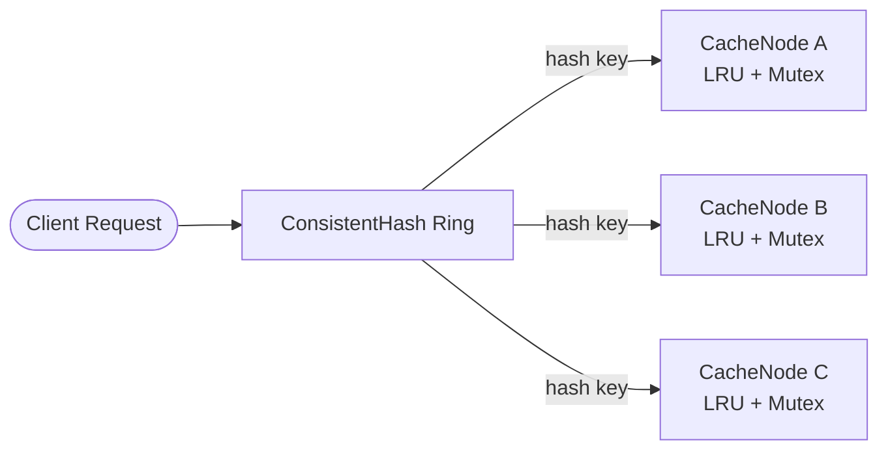
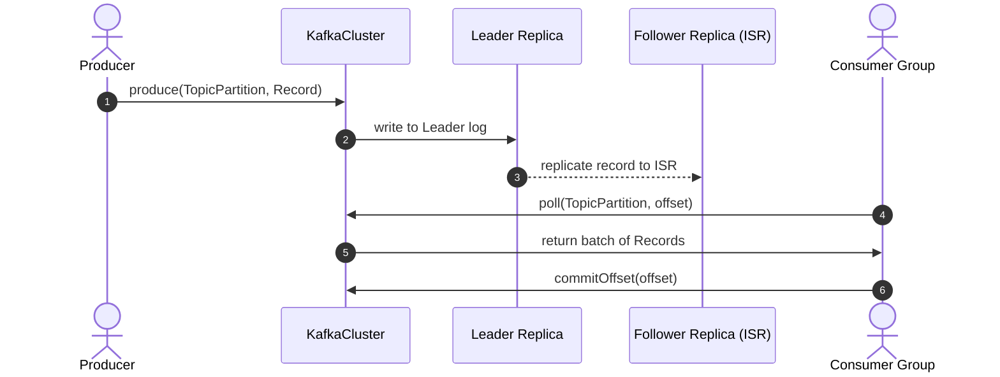

# System Design & Low-Level Design (LLD) in Modern C++

[](https://en.cppreference.com/)
[]()
[]()
[]()
[]()

Production-grade Low-Level System Designs (LLD) and distributed systems primitives engineered in modern C++ (C++17). This repository features complete, object-oriented implementations of critical infrastructure components (distributed caching, message queues, rate limiters, and messaging platforms) with a strong emphasis on clean code, SOLID principles, design patterns, concurrency safety, and algorithmic efficiency.

---

## 📑 Table of Contents

- [Repository Overview](#-repository-overview)
- [Directory Structure](#-directory-structure)
- [Modules Deep-Dive](#-modules-deep-dive)
  - [1. Distributed In-Memory Cache](#1-distributed-in-memory-cache-cache)
  - [2. Distributed Message Queue (Apache Kafka)](#2-distributed-message-queue-apache-kafka-kafka)
  - [3. High-Performance Rate Limiter](#3-high-performance-rate-limiter-ratelimiter)
  - [4. WhatsApp / Messenger Architecture (LLD)](#4-whatsapp--messenger-architecture-lld-whatsapp)
  - [5. High-Level Design Reference](#5-high-level-design-reference-hldpdf)
- [Design Patterns & Engineering Best Practices](#-design-patterns--engineering-best-practices)
- [Quick Start: Build & Run](#-quick-start-build--run)

---

## 🚀 Repository Overview

| Module | Core Concept | Key Patterns & Technologies | Highlights |
| :--- | :--- | :--- | :--- |
| [**Cache**](./Cache) | Distributed Caching | Consistent Hashing Ring, LRU, TTL, RAII | Minimizes rehashing churn, node auto-routing, thread-safe entries |
| [**Kafka**](./kafka) | Distributed Event Streaming | Leader-Follower Replication, ISR, Failover Controller | Append-only commit log, automated leader election, consumer offsets |
| [**Rate Limiter**](./ratelimiter) | API Traffic Control | Strategy, Factory, Token/Leaky Bucket, Sliding Windows | 5 battle-tested algorithms, boundary burst mitigation, API gateway |
| [**WhatsApp**](./whatsapp) | Real-time Chat Platform | Inheritance, Polymorphism, Observer, Unit Testing | 1:1 & group chats, message statuses, media handling, full test suite |
| [**HLD Notes**](./HLD.pdf) | Scalable System Design | Distributed Systems Principles | Comprehensive reference for large-scale distributed architectures |

---

## 📂 Directory Structure

```text
System-Design/
├── Cache/
│   ├── cache.cpp             # Distributed cache with Consistent Hashing & LRU eviction
│   └── cache                 # Compiled executable
├── kafka/
│   ├── kafka.cpp             # Distributed commit log, ISR replication & leader election
│   └── kafka                 # Compiled executable
├── ratelimiter/
│   ├── ratelimiter.cpp       # 5 rate limiting algorithms + ApiGateway + unit tests
│   ├── ratelimiter           # Compiled executable
│   └── LLD-ratelimiter.jpeg  # Rate limiter architectural design diagram
├── whatsapp/
│   ├── whatsapp.cpp          # Full WhatsApp LLD (User, Chat, Message, Notifications, Tests)
│   ├── whatsapp              # Compiled executable
│   └── LLD-whatsapp.jpeg     # Messaging platform class & domain diagram
├── HLD.pdf                   # High-Level System Design architectural guide
└── README.md                 # Project documentation
```

---

## 🔍 Modules Deep-Dive

### 1. Distributed In-Memory Cache (`/Cache`)

A scalable, distributed key-value cache that seamlessly routes requests across independent cache nodes using consistent hashing.

#### Architectural Highlights
- **Consistent Hashing Ring (`ConsistentHash`)**:
  - Utilizes an ordered `std::map<unsigned long, string>` ring to distribute keys across cache nodes.
  - Efficient lookup using binary search (`std::map::lower_bound`) in $\mathcal{O}(\log N)$ time, avoiding full-cluster reshuffling when nodes scale up or down.
- **Pluggable Eviction Strategy (`EvictionPolicy`)**:
  - Abstract base strategy with a complete **LRU (Least Recently Used)** implementation using an internal doubly-linked list (`std::list`) and fast iterator index lookup (`std::unordered_map`) for $\mathcal{O}(1)$ updates.
  - Extensible interface to support LFU, FIFO, or ARC policies.
- **Time-to-Live (TTL) Eviction**:
  - Millisecond-precision passive expiration via `steady_clock`. Expired keys are evicted automatically on access.
- **Thread Safety**:
  - Each `CacheNode` guards its internal memory and eviction state using `std::mutex` and `std::lock_guard`.



---

### 2. Distributed Message Queue: Apache Kafka (`/kafka`)

An in-memory, distributed event-streaming engine modeling the core internals of Apache Kafka.

#### Architectural Highlights
- **Append-Only Commit Log (`Replica`)**:
  - High-throughput sequential message ingestion with zero-indexed sequential offsets.
- **Partition Replication & In-Sync Replicas (`Partition`)**:
  - Partitions maintain a designated **Leader Broker** and a dynamic **In-Sync Replicas (ISR)** set.
  - Reads and writes route to the leader; writes propagate synchronously across all active ISR members.
- **Automated Leader Election & Failover (`Controller`)**:
  - The cluster Controller continuously monitors broker health.
  - On node crash, the failed broker is evicted from the ISR, and a new leader is elected instantly from remaining healthy replicas.
  - Emits real-time state change notifications via `ClusterListener`.
- **Consumer Groups & Offset Store (`ConsumerGroup`, `OffsetStore`)**:
  - Tracks individual partition progress per consumer group, supporting at-least-once processing semantics and offset commits.



---

### 3. High-Performance Rate Limiter (`/ratelimiter`)

A multi-strategy traffic throttling engine providing protection against DDoS attacks, burst traffic spikes, and API quota abuse.

#### Algorithms Implemented & Compared

| Algorithm | Time Complexity | Space / User | Handles Bursts? | Boundary Safe? | Ideal Use Case |
| :--- | :---: | :---: | :---: | :---: | :--- |
| **Fixed Window Counter** | $\mathcal{O}(1)$ | $\mathcal{O}(1)$ | ❌ No | ❌ No (2x burst) | Simple per-hour/day quotas |
| **Sliding Window Log** | $\mathcal{O}(\log N)$ | $\mathcal{O}(N)$ | ✅ Yes | ✅ Yes | Strict, low-volume APIs |
| **Sliding Window Counter**| $\mathcal{O}(1)$ | $\mathcal{O}(1)$ | ⚠️ Smoothed | ✅ Yes | High-traffic services |
| **Token Bucket** | $\mathcal{O}(1)$ | $\mathcal{O}(1)$ | ✅ Configurable | ✅ Yes | REST APIs allowing brief bursts |
| **Leaky Bucket** | $\mathcal{O}(1)$ | $\mathcal{O}(W)$ | ❌ Smooth rate | ✅ Yes | Egress traffic shaping & queues |

#### Design Patterns Used
- **Strategy Pattern (`RateLimiterStrategy`)**: Decouples rate-limiting algorithms from consumer code.
- **Factory Pattern (`RateLimiterFactory`)**: Instantiates appropriate algorithm strategies dynamically based on configuration.
- **API Gateway Integration (`ApiGateway`)**: Centralized request throttling layer with thread-safe client tracking.
- **Visual Diagram**: Inspect [LLD-ratelimiter.jpeg](file:///Users/shikshakkumar/Downloads/development/System%20Design/ratelimiter/LLD-ratelimiter.jpeg) for the full architecture.

---

### 4. WhatsApp / Messenger Architecture: LLD (`/whatsapp`)

A comprehensive low-level design for an enterprise-grade messaging service supporting billions of messages, media delivery, user status updates, and group operations.

#### Architectural Highlights
- **Domain Modeling**:
  - `User`: Handles identities, profiles, last-seen timestamps, and contact associations.
  - `Status`: Ephemeral 24-hour status stories with automated TTL validation.
- **Polymorphic Message Engine**:
  - Base abstract class `Message` extended by `TextMessage` and `MediaMessage` (supporting Images, Audio, Video, Documents).
  - Lifecycle state machine: `SENT` $\rightarrow$ `DELIVERED` $\rightarrow$ `READ`.
  - Rich capabilities: message editing, soft-delete, and preview summaries.
- **Conversation Hierarchy**:
  - `PrivateChat`: Direct 1:1 communication between two users.
  - `GroupChat`: Multi-user chat with role-based member management (Admins, Participants).
- **Core Platform Services**:
  - `MessageService`: Centralized chat creation, message routing, and history retrieval.
  - `NotificationService`: Event-driven notification dispatches for new messages and group updates.
  - `Backup`: Data persistence abstraction for cold storage and message restoration.
- **Visual Diagram**: Inspect [LLD-whatsapp.jpeg](file:///Users/shikshakkumar/Downloads/development/System%20Design/whatsapp/LLD-whatsapp.jpeg) for the domain model.

---

### 5. High-Level Design Reference (`HLD.pdf`)

A curated guide covering core High-Level System Design principles:
- Scalability patterns (Vertical vs. Horizontal scaling, Sharding, Read Replicas)
- Caching strategies (Cache-aside, Write-through, Write-behind, Eviction algorithms)
- CAP Theorem, PACELC theorem, and distributed consistency models (Strong, Eventual)
- Load balancers, microservice gateways, and asynchronous event-driven pipelines

---

## 🛠️ Design Patterns & Engineering Best Practices

- **SOLID Principles**:
  - **S**: Every class (e.g., `Replica`, `ConsistentHash`, `RateLimiterStrategy`) has a single focused responsibility.
  - **O**: Extensible architectures (e.g., adding a new eviction policy or rate-limiting algorithm requires zero changes to existing classes).
  - **L**: Derived classes (`TextMessage`, `GroupChat`, `LRUPolicy`) fully substitute their base interfaces.
  - **I**: Clean, granular interfaces preventing bloated contracts.
  - **D**: High-level managers depend on abstractions (`EvictionPolicy`, `RateLimiterStrategy`), not concrete implementations.
- **Modern C++ Idioms**:
  - **Smart Pointers**: Complete memory safety using `std::unique_ptr` (strict ownership) and `std::shared_ptr` (shared ownership) with zero raw memory leaks.
  - **Move Semantics (`std::move`)**: High-efficiency resource transfers eliminating unnecessary heap allocations.
  - **Concurrency Primitives**: Race-condition-free access via `std::mutex`, `std::lock_guard`, and `std::atomic`.
  - **Defensive Type Safety**: `std::optional`, `enum class`, and modern `chrono` clocks.

---

## ⚡ Quick Start: Build & Run

### Prerequisites
- GCC / G++ (version 7+ supporting C++17) or Clang (version 6+)
- Make or CMake (optional)

### Compile & Run Individual Modules

#### 1. Distributed Cache
```bash
cd Cache
g++ -std=c++17 cache.cpp -o cache_demo
./cache_demo
```

#### 2. Distributed Message Queue (Kafka)
```bash
cd kafka
g++ -std=c++17 kafka.cpp -o kafka_demo
./kafka_demo
```

#### 3. Rate Limiter
```bash
cd ratelimiter
g++ -std=c++17 ratelimiter.cpp -o ratelimiter_demo
./ratelimiter_demo
```

#### 4. WhatsApp Messaging Engine
```bash
cd whatsapp
g++ -std=c++17 whatsapp.cpp -o whatsapp_demo
./whatsapp_demo
```

---

## 🤝 Contributing & Extensions

Ideas for further extensions:
- [ ] Add **LFU (Least Frequently Used)** eviction policy to `/Cache`.
- [ ] Implement persistent disk logging and segment files in `/kafka`.
- [ ] Integrate Redis-based distributed token bucket rate limiting.
- [ ] Implement WebSocket transport abstraction for `/whatsapp`.

---

## 📄 License
This project is open-source and available under the [MIT License](LICENSE).
